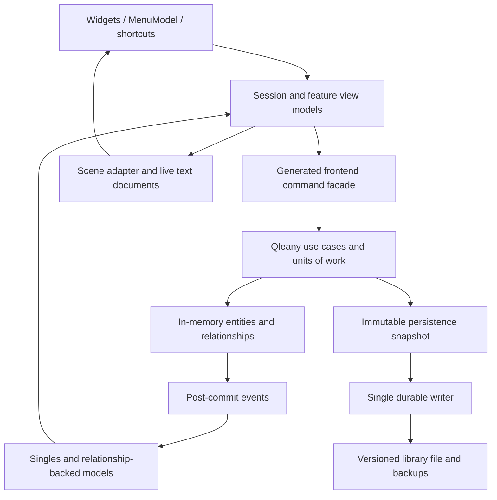

# Noton architecture proposal

Status: planning proposal, 17 September 2026. No application or upstream code changed.
Owner selected tables and best-effort ink, plus Linux/Windows/macOS using Skribisto CI.
Owner selected **A: canvas + editable linear view, with movable ink sketch blocks**.
[Decision and alternatives](page-options.md). This session remains planning-only.
The recommendations below define a complete candidate product, not a promise of OneNote parity.

## 1. Product and navigation

Build a local-first Rust desktop notebook with exactly two visible organisational levels:
**Folder → Note**. A library is a file/session boundary, not a third navigation tree level.
Do not add subfolders, subpages, notebooks-inside-notebooks, or DockingLayout.

Recommended layout:

```text
┌─────────────────────────────────────────────────────────────────────┐
│ TitleBar: [☰] Noton                  current library      OS controls│
├───────────────┬───────────────────┬─────────────────────────────────┤
│ Folders       │ Notes             │ Note title                      │
│ [+ Folder]    │ [+ Note] [Search] │ Contextual formatting / Insert  │
│               │                   ├─────────────────────────────────┤
│ Work          │ Meeting           │                                 │
│ Personal      │ Research          │ Scene with editable blocks      │
│               │                   │                                 │
├───────────────┴───────────────────┴─────────────────────────────────┤
│ Saved / Saving / Save failed                   Canvas | Reading view│
└─────────────────────────────────────────────────────────────────────┘
```

Use two virtualized `ListView`s, identity-based selection, and accessible `Splitter`s.
Start at roughly 180 / 250 logical pixels for the two lists, but derive minimums from
text scale and control contents. On narrow windows collapse navigation into a single
Folders → Notes panel with Back; preserve selected IDs, list scroll, and editor caret.
Navigation never changes the underlying two-level hierarchy. F6 cycles regions;
Shift+F6 reverses. Arrow keys navigate lists; Enter opens; Escape leaves transient UI.
Drag reorder and move-to-folder commands must be equivalent operations.

The selected page model is free-positioned rich-text/table, image and drawing blocks plus an editable
linear Reading view over the **same** blocks. This is one document model with two
presentations. It avoids two page formats and gives non-spatial access to all content.
Reading order is explicit, independent of x/y and paint z-order, and user-reorderable.
Changing the view never changes content or geometry. Reading view is available to everyone;
the canvas must also be accessible in its own right.

Use `TitleBar`, `WindowFrame`, and one `MenuModel`. Render a hamburger on Linux/Windows;
mirror the same model to the macOS native menu using Skribisto's pattern on macOS. Provide native-decoration fallback when no title-bar host is available.
Menu, toolbar, keyboard, context menu, and automation invoke the same typed intents.
No duplicated menu command implementations or hand-maintained shortcut labels.

## 2. Scope decisions

See [feature choices](feature-choices.md). Suggested baseline: rich text, checklists,
images with alt text, links, search, trash/restore, native portable backup and HTML/text
export, settings, French/English, autosave and accessible operation.
Tables and best-effort ink are selected. Tags, attachments, audio, OCR, PDF annotation,
templates, retained page versions, sync/collaboration and OneNote import are not selected. These are
product scope choices, not automatically promised subsequent releases.

For rich text, initially offer paragraph/headings, bold/italic/underline/strike,
bullets/numbering, checklists, links, and paragraph alignment only when each supported
construct passes the storage round-trip and accessibility gates. Do not expose a toolbar
feature that the chosen codec drops. Typography defaults belong in settings; explicit
formatting belongs in the document. Paste is sanitised and limited to the supported set.

## 3. Architecture and ownership



Recommended modules/crates:

| Component | Responsibility |
|---|---|
| Generated `common`, `direct_access`, `macros`, `frontend` | Entity types, repository contracts, event infrastructure, Qleany history, UI facade |
| `library_management` | Open/create/close, checkpoint, recovery, backup, format migration |
| `note_management` | Folder/note creation, rename, ordering, move, trash and restore |
| `page_management` | Block insertion/removal, geometry, reading order, content flush |
| `search_management` | Derived text index and queries, stable result identities |
| `noton_format` | Versioned file schema, asset storage, validation and migrations; no widgets |
| `teksilo_ui` | Singles/models, session, scene/text adapters, menu, settings and views |

Keep business invariants in use cases, never in button callbacks. Generated singles
provide entity editing signals, but a multi-entity operation uses a custom use case and
one unit of work, not several independent `.save()` calls. Treat generated direct CRUD
as infrastructure: the UI must not use it to bypass folder ownership, trash, or asset rules.

UI-owned `Signal`, `SceneModel`, widgets, handles and observers stay on the UI thread.
Only immutable data snapshots cross to persistence/search workers. The generated event
source marshals post-commit events back to the UI. Qleany Rust ordinary use cases are
synchronous; do not assume marking a command undoable makes it background work.

`Session` owns active library/folder/note IDs and the service lifetimes. `SingleFolder`,
`SingleNote`, `SingleBlock` expose the selected records. Generated library-folder and
folder-note models read **owner relationships**, not `get_all`, preserving containment
and ordering. Bind keys to entity identity, never visual indexes. Build-scoped event
subscriptions must be renewed on each build; session-owned observers have explicit RAII
lifetimes. Self-originated content flushes must not reload the active editor.

Separate persisted content, transient editing buffers, and UI preferences. The Qleany
store owns committed metadata/relationships. The live `TextDocument` is authoritative
for its unflushed text; the snapshot barrier reconciles it before any save/export/search
operation that promises current content. Scene geometry is a UI projection except during
a user preview/commit; an adapter validates and commits the corresponding domain change.
This authority handoff must be explicit—there are not three independently writable copies.

## 4. Domain and identity

| Entity | Fields and ownership |
|---|---|
| Root | Non-undoable process/session root; strongly owns open libraries |
| Library | Durable UUID, title; strongly owns ordered folders and assets |
| Folder | UUID, title, trashed state; strongly owns ordered notes; no parent folder |
| Note | UUID, title, trashed state; strongly owns ordered blocks |
| Block | UUID, kind, trashed state, position, width, sizing policy, z-order, versioned content; optional weak asset reference |
| Asset | UUID, content digest, MIME type, original filename, byte length; bytes stored once |

A Drawing block owns ordered InkStroke records (UUID,
versioned vector sample payload and brush attributes), with a title/description at drawing
level. This is part of the selected page model. Stroke coordinates are local to the sketch;
its placement and viewport never rewrite the original samples. Rendered ink is clipped to
the sketch bounds. Canvas movement does not change reading order.
Tables remain in TextDocument rich content; do not create a second spreadsheet/table model.

All entities under an undoable trunk must also be undoable, as Qleany requires. Preferences,
camera state, selected IDs, search caches and save progress are outside that ownership tree.
A non-history content-flush use case can update an undoable entity without adding an undo
entry; `stack_id = None` is NOT that mechanism (it selects Qleany's global stack).

Use Qleany numeric IDs inside a session; persist UUIDs in files and note/block links.
On load allocate/remap numeric IDs, rebuild relationships, and validate uniqueness.
Never serialize `ItemId`, `WidgetId`, pointers, `Signal`s or the generated store layout.
Maintain explicit `BlockId ↔ ItemId` maps in the scene adapter.

Ordered relationships are the canonical folder/note/reading order. Geometry is finite,
validated logical scene units; zoom is presentation state and never multiplies persisted
positions. Give rich-text blocks a stored width and content-driven height; image aspect
ratio preservation is the default. Reject NaN/infinity, negative sizes and unsupported
format versions. Do not infer reading order from overlapping bounds.

Soft deletion of folders, notes and blocks keeps original relationships and ordering; active models filter the tombstones. A note is effectively trashed
if it or its containing folder is trashed. Restoring a note under a trashed folder asks
for an active destination or restores the folder explicitly. Permanent purge is a separate
operation, names what it removes, and clears histories that could refer to the removed
objects; deletion must not depend on a disappearing toast for recovery.

Deleting the last folder leaves an empty library with a clear Create folder action.
Duplicate creates new UUIDs, copies supported content, rewrites links inside the duplicated
selection, preserves links to other notes, and retains shared immutable assets.
Renaming does not break links. A trashed/deleted link target is reported, never silently
redirected. Move Note updates both folder relationships atomically and is one undo action.

## 5. Scene integration

Use `SceneModel` + `SceneView::with_model`, with `add_widget_item` payloads and per-view
widget delegates. Text blocks contain genuine `RichTextEditor`s; user-facing images are
semantic widgets/items with alt text and explicit editing commands. Lightweight items are
appropriate for decorative grids, selection outlines and guides; exclude decoration from
AT. Keep actionable chrome in heavyweight widgets to avoid the documented overlay hit
ordering discrepancy.

`SceneListAdapter` currently adapts lightweight `SceneItem`s, not heavyweight editors;
do not pretend it supplies this bridge. Own a small keyed `PageSceneAdapter` that applies
block add/remove/reorder changes and preserves editor/document identity. Update text via
stable document handles and signals: `set_payload` rebuilds the widget and can disrupt the
caret. Retain only the active page scene; retain text-history documents according to an
explicit bounded session policy, never silently evict a dirty document.

For scene-native user gestures, the edit sink receives one transaction record. Translate
its geometry changes into plain domain before/after values and execute one Qleany command.
Record only committed user edits. Backend replay projects with
`ChangeSource::Programmatic` and `HistoryMode::Ignore`; guard the adapter against feedback.
Failed validation rolls the scene back to the authoritative domain state with history
ignored. `abandon()` does not roll back automatically: invert or reproject explicitly.

Insert/delete/duplicate should enter through domain commands and then project to the
scene, rather than destroying a widget and trying to store the salvage in Qleany.
`UndoRedoCommand: Send` cannot own `Rc<RefCell<Scene>>` or widget boxes. Transient scene
salvage belongs on the UI side; persistent commands own DTOs/IDs/geometry only.

Use geometry constraints before gesture commit for bounds/snap rules so preview and
committed placement agree. One drag, keyboard nudge group, or multi-block resize produces
one history action. Camera pan/zoom, selection and content-height relayout are not edits.
Moving a block must not select its text; text selection must not start a block drag.
Use a dedicated block handle/header and test mouse, touch, IME and cancellation.

The documented retention mechanism parks offscreen widgets but still materializes them;
it is not full virtualization. Do not claim enormous rich-editor scenes are cheap.
Measure active-page cost with 20, 200 and 1,000 blocks before setting supported bounds.
An accessible block navigator must reach every block independently of viewport culling.

## 6. Undo/redo contract

Recommended: Skribisto-style explicit domains, not a fabricated global scene/text journal.
Text-document itself already has Qleany-backed text history and rich editor integration.
Noton's Qleany history owns structural operations.

| Focus/context | Undo owner |
|---|---|
| Rich-text caret | That block's TextDocument history, including formatting |
| Search/rename/settings text field | The focused field's native text history |
| Page block selection / block properties | Current note's Qleany structural stack |
| Folder or note list | Current library's Qleany organisation stack |
| Menu/toolbar opened from an editing surface | Latched originating scope |
| Modal dialog | Dialog-local behaviour; application histories suspended |

An empty text stack must not fall through and undo a folder operation. Menu labels name
the action and target. Page-switching retains the owning stacks for the library session;
closing the library ends session undo. Undo history is not persistent page version history.

Flush current editor revisions before a command captures/deletes/moves content. Structural
undo patches only the fields it owns, never restores an old whole-note snapshot over newer
text. Remove/trash retains the document identity and history while it remains recoverable;
restore rejoins it only if its stored content still matches. Undoing creation is also a tombstone operation once an object exists: a note or block may
have subsequent edits in another history scope. It must not cascade-delete those edits.
Redo revives the latest retained object, not its empty creation snapshot. Custom creation
commands therefore own identity/membership/visibility and retain the object for replay;
do not use generated cascade-create undo unchanged for this interaction. While trashed,
its editing scopes are suspended. Undoing library-folder creation hides its retained
subtree by the same rule. Permanent purge destroys the relevant histories. Cross-note block moves are outside the baseline; do not sneak in
cross-stack transfers without an explicit atomic history design.

Use an application-owned committed semantic revision per live document. The current
`TextDocument::content_revision()` only counts `ContentsChanged`; it is insufficient for
format-only edits. Observe content/format/reset signals through a UI-thread event queue,
classify app loads/replay and composition separately, and compare the canonical persisted
payload before advancing the committed revision. `document_version` is a useful candidate
invalidation signal, not a durable-edit counter: it also includes loads and IME previews.
Formatting notifications caused solely by search/spelling highlights produce no persisted
payload change and no dirty revision. Flush barriers drain these notifications even if no
editor frame has run. Test formatting-only changes and programmatic mutations explicitly.

Text flush is untracked and must preserve structural redo. Own-origin entity events must
not call `set_djot_sync`, which clears text history. Break typing merge at focus changes,
structural steps and explicit edits, not on an autosave timer. Formatting-only changes,
undo, redo, image changes and checklist changes all count as dirty.

A single chronological undo sequence mixing typing and block moves would require a
stronger external text history integration. It is a different architecture choice, not
something achieved by observing `on_change`. If the owner requires it, specify and get
approval for the upstream seam before implementing it.

## 7. Persistence and autosave

Recommendation: one portable `.noton` SQLite library file, with versioned tables for
metadata, ordered relationships, block content and immutable asset blobs. This is the
file-format layer beneath Qleany's in-memory store, not a replacement for generated
repositories. Unlike rewriting a whole ZIP containing media for every keystroke, changed
rows can be checkpointed transactionally. Keep one writer per canonical library path and
an exclusive application lock; a second opener gets read-only access or a clear conflict.

SQLite is a proposed new format dependency, not something Qleany generates. Use local
files, foreign-key/ownership validation, explicit transactions and full durability.
Prefer rollback-journal mode initially, with `synchronous=EXTRA` and verified filesystem durability, for a portable file with simple lifecycle; a
copyable consistent backup is still produced through SQLite's backup API, not by copying
an open file. See [SQLite atomic commit](https://www.sqlite.org/atomiccommit.html),
[durability settings](https://www.sqlite.org/pragma.html#pragma_synchronous) and
[backup API](https://www.sqlite.org/backup.html). Do not call an active database in a consumer sync folder a sync solution.

Block text candidate: UTF-8 Djot with a Noton codec version, following Skribisto's existing
text-document bridge. The approved formatting subset must round-trip including links,
checklists, tables, language, and image references. Exact structural equality
of the supported semantic model, not byte-for-byte markup equality, is the gate. If Djot
cannot preserve an approved feature, supply an explicit lossless codec/extension and its
migration before exposing that feature; never silently downgrade it to Markdown.

Autosave state machine:

1. Every effective content/structural edit advances a monotonic library `edit_seq`.
2. Save after 750 ms idle, with a 5 s maximum interval under continuous edits. These are
   initial product targets, not existing measured behaviour.
3. At a UI-thread barrier, finish committed text edits, flush dirty documents using application-owned
   committed semantic revisions, and capture a coherent immutable snapshot/delta at sequence N.
   IME preedit remains provisional; save previously committed text and wait for composition
   commit/cancel before close. Never persist half of an IME composition as committed text.
4. One writer commits the snapshot transaction. Requests during a save coalesce into a
   required next save; they are not discarded. Workers never read changing UI buffers.
5. Acknowledge `saved_seq = N` only after successful durable commit. UI is Saved exactly
   when `saved_seq >= edit_seq`. A save started before further typing cannot clear it.
6. Ctrl+S, close, library switch and export request a barrier sequence and await coverage.
   On failure retain buffers and show retry / save-copy / cancel-close actions. No quiet
   close or success toast on failure. Backpressure cannot drop unsaved edits.

A normal crash can lose the uncommitted debounce window; state that limit honestly. A
completed durable save must survive restart. Continuous typing must not postpone saves
indefinitely. Checkpoint changed rows with version stamps; clear only the revisions actually
covered. Undo may produce identical content but still advances the sequence for saving.

Asset ingest validates byte/decode limits, copies bytes before committing references,
uses digest deduplication with full-byte collision verification, and never relies on the
original external path. Failed import leaves no live reference. Retain assets reachable
from content, trash or live undo records. Garbage collection runs only at a safe history
boundary and never deletes data needed by a recoverable edit.

Backups are separate from autosave: retain five successfully verified library snapshots,
with visible restore UI. Migration makes a verified backup, validates the old file, migrates
transactionally, then validates ownership/content. Newer unsupported schemas open only
when safely readable without data loss, otherwise refuse without touching the file.

## 8. Accessibility and French/English

Treat “100% a11y” as a release requirement that every shipped workflow works with keyboard
and supported assistive technology. It is not a percentage inferred from AccessKit nodes.
MCP exercises internal semantics; real platform screen-reader tests are additionally required.

- Explicit names, roles, states, descriptions, error associations and actionable AT
  handlers; every advertised action must execute, not merely appear in a snapshot.
- A stored reading order; block navigator and Reading view expose all content, including
  offscreen blocks. Focus reveals the target. Test canvas traversal and linear traversal.
- Keyboard create/select/move/resize/reorder/delete/restore, with precise numeric properties
  and menu alternatives to drag. No pointer-only handles, hover-only discovery or traps.
- Rich text supports caret/selection navigation and reading at character/word/line level;
  images have author-provided alt text or an explicit decorative designation. Checklists
  expose operable checked state; a painted checkbox is insufficient.
- All dialogs restore focus; opening menus preserves undo scope; switching views preserves
  block identity and caret. Escape cancels a gesture without changing saved state/history.
- Text scale up to 200% as an initial test target, high contrast, reduced motion, visible
  unobscured focus, adequate hit targets, and no colour-only information. Canvas zoom and
  UI text scale are separate. Reading view reflows when the canvas cannot.
- Use Teksilo announcement APIs for operation results/errors, avoiding duplicate toast
  announcements. Do not announce every successful autosave or every drag sample.
- Persistent trash and error actions remain available after notifications disappear.

Ship `en-US` and `fr-FR` Fluent resources, compile-time message/argument checks and parity
checks for labels, menus, shortcuts, settings, errors, status, tooltips and AT announcements.
Settings offers System / English / Français with immediate UI and AT updates. Unsupported
system locale falls back to English. User note text is never translated or renamed by a
locale switch. Content language, spellcheck if selected, and UI locale are separate.

Settings: language, System/Light/Dark appearance, text scale, reduced motion/system
preference, navigation density, default note view, backup location/retention, and shortcut
settings. Autosave stays enabled; the user always sees failures. Use Teksilo settings APIs
for UI preferences and window state, never as the content database.

## 9. Search and export

Search title and committed/current edited text across active notes, with optional explicit
trash scope. Results carry library/note/block UUID and revision; refresh stale positions
before revealing. Use text-document's addressable character offsets rather than byte
positions or exported plaintext offsets (tables can change these). Opening a result selects
the right folder/note and reveals the exact block/range in either presentation.

Start with a rebuildable in-process index plus dirty-document overlay; benchmark before
adding a heavyweight search engine. English/French case/diacritic matching is defined and
tested, with original text retained for highlights. Format-only edits must not invalidate
text positions unnecessarily. Search is not an undoable edit.

Native backup/export is lossless. HTML/text exports follow explicit reading order and state
that spatial placement is not preserved. Export is a frozen coherent snapshot with embedded
or bundled assets and escaped text/URLs. PDF/layout export, if selected, needs an explicit
pagination and accessible-output contract rather than a screenshot of an infinite canvas.

## 10. Implementation order and acceptance gates

These are completion gates for the approved product, not a schedule of deferred features.
Do not ship a stage on its own as the finished app.

| Gate | Deliverable and pass condition |
|---|---|
| A: scope and reproducibility | Owner answers recorded; dependency revisions pinned; candidate manifest validated; upstream changes separately approved |
| B: integrated editor proof | Real note with two rich editors and an image; zoom/pan, IME, keyboard, AT, focus and undo all work with no competing histories |
| C: durable vertical slice | Folder → note → edit → autosave → kill → reopen; revisions, file lock, disk failure, retry and close guard tested |
| D: complete domain | Every approved CRUD/order/trash/link/asset action atomic, undoable where specified, persisted and tested; no generated stub reachable |
| E: complete shell | Responsive two-list UI, TitleBar/MenuModel, settings and both locales; real/mocks surfaces agree |
| F: full validation | Automated scenarios plus real screen-reader matrix, corruption/recovery tests and measured performance budgets |
| G: release | Packages on all selected platforms, file association/icons, migration fixtures, documented shortcuts/backup/limitations; all gates pass |

Before generation commit the manifest/planning baseline. Run `qleany check`, inspect
`qleany list files` and `qleany generate --dry-run`; then generate intentionally. Keep
infrastructure generated, use-case bodies owned, and aggregate changes reviewed. Never
blanket-regenerate edited scaffolds. Use `qleany prompt -u feature:use_case` for each body.

Minimum custom operation contracts: create/open/close/save-copy/backup/restore library;
create/rename/reorder/trash/restore folder; create/rename/move/duplicate/trash/restore note;
insert/remove/duplicate/transform/reorder block; flush text without history; import asset;
search and export. Purge validates reachability and history invalidation. Each returns a
typed error and emits events only after commit. Multi-step operations must roll back
atomically; a Qleany composite alone is not proof of transactional atomicity.

## 11. Risks and approval boundary

| Risk | Required response |
|---|---|
| Mixed scene/text history | Use the explicit domains above; integrated tests prove routing and autosave behaviour |
| Scene overlay AT hit order | Avoid actionable lightweight overlays above editors; reproduce and request upstream approval if unavoidable |
| Scene materialization cost | Measure page-size envelope; do not advertise full virtualization |
| Codec loses selected formatting | Round-trip corpus blocks release until a lossless approved implementation exists |
| Partial save or old save finishes last | Serialized writer, snapshot revisions and failure-injection tests |
| Generated scaffolds overwritten | Commit + selective generation + reviewed aggregate diffs |
| Native AT differs from MCP | Real screen-reader testing on every selected platform is a release gate |

No upstream fixes are authorised by this document. For each proven upstream issue, present
the reproducer, expected/actual behaviour, affected crate/API, minimal patch scope,
regression test and alternative app-level design to the owner; ask before editing Teksilo,
teksilo-scene, text-document or Qleany. This session changed none of them.

## 12. Alternatives considered

| Decision | Recommended choice | Why the alternatives lose here |
|---|---|---|
| Navigation | Two scoped lists | A tree encourages forbidden extra levels; tabs obscure folder contents; DockingLayout is expressly excluded |
| Page types | Canvas + linear projection of one model | Separate document/canvas formats double paste, search, migration and export contracts |
| Persistence | Incremental SQLite library file | Whole ZIP rewrite scales with media on every save; directory bundles complicate multi-file atomic commit and portable moves |
| Backend | Generated Qleany ephemeral store | Direct SQLite writes from widgets bypass commands/events/history; swapping the generated repository backend adds needless generator maintenance |
| History | Explicit text/page/library domains | One app-wide history can change unrelated notes; a unified page journal needs a text transaction seam not established here |
| Widget integration | Stable payload-backed editors | Painting text as scene labels loses editing/AT; recreating payloads per key loses caret and history |
| Sharing | Local-first unless explicitly selected | Sync requires a conflict/identity protocol, not a background file copier |

These are recommendations. Selecting a different product requirement triggers a concrete
revision of the affected contracts, not an attempt to hide the mismatch in implementation.

## 13. Accepted scope update

Tables are required, including insert/delete table, row/column editing, keyboard and AT cell
navigation, text/format editing, undo/redo, search and lossless persistence. Their content
uses the existing rich-text document semantics. Tests cover empty cells, non-ASCII text,
wide tables, paste, row deletion undo and save/reopen. They are no longer optional gates.

Ink is required with best-effort physical tablet support. See [page options](page-options.md)
for the vector model, pointer cancellation, accessible textual equivalents and platform
capability limits. Without hardware, record physical pressure/tilt/eraser behaviour as
unverified; mouse drawing, synthetic samples, undo/redo and storage must still pass.
The selected contract is movable drawing blocks; unrestricted annotation across text
is outside scope. Text reflow does not alter sketch geometry. Sketches retain aspect ratio
in linear view, with their descriptions and explicit editing commands available.

All three desktop platforms are required. [CI adaptation](ci-plan.md) names the Skribisto
workflows, helper actions and scripts to reuse and the necessary Noton changes. The guide
at `/home/cyril/Devel/skribisto/.claude/CLAUDE.md` is now read; follow its feature-first
MVVM layout, `*_vm.rs` naming, real/mock Layer-A seams, preference for `teksu!`, menu-global
action registration and explicit session ownership. Its commit/push-only-when-asked rule
is adopted: subsequent planning updates are left uncommitted unless requested.

No use case calls another use case: share pure domain helpers instead. After scaffolding,
use-case/UoW macro contracts are owned together; generated file classification alone is not
permission to overwrite a modified UoW, controller or Cargo manifest. Review exact diffs.
Avoid EditorHandle mutations inside editor `on_change` callbacks, which can hold editor
borrows; queue work and reconcile at the frame/barrier boundary.
